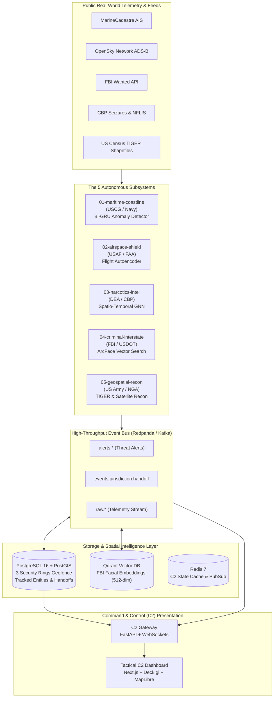

# PROJECT FRONTIER (FRONTIER-C4ISR)
### Homeland Defense & Border Protection System of Systems (SoS)

[](https://www.python.org/downloads/)
[](https://pytorch.org/)
[](https://colab.research.google.com/github/maykonlincolnusa/FRONTIER-OS-Frontier-Operating-System-/blob/main/ml-training/frontier_c4isr_tpu_training.ipynb)
[](https://postgis.net/)
[](https://redpanda.com/)
[](https://qdrant.tech/)
[](https://fastapi.tiangolo.com/)
[](LICENSE)

---

## 1. Executive Summary

**Project Frontier** is an enterprise-grade **C4ISR** (*Command, Control, Communications, Computers, Intelligence, Surveillance, and Reconnaissance*) platform engineered for United States territorial integrity and multi-agency border enforcement. 

The architecture unifies live public telemetry, open-source intelligence (OSINT), and Deep Learning perception across federal, maritime, airspace, and interstate jurisdictions (USCG, US Navy, USAF, FAA, US Army, NGA, CBP, DEA, FBI, and USDOT).



---

## 2. The 3 Defense-in-Depth Security Rings

Target tracking and interception operate under a **Defense-in-Depth** doctrine. When an entity (vessel, aircraft, ground vehicle, or individual) crosses from one jurisdictional polygon to another, **PostGIS** detects the boundary breach and emits a `JURISDICTION_HANDOFF` event on the Redpanda message bus:

| Security Ring | Boundary & Geometry | Responsible Agencies | Handoff Trigger |
| :--- | :--- | :--- | :--- |
| **RING 1: MARITIME & BLUE BORDER** *(Outer Perimeter)* | Territorial Sea (12 NM), Contiguous Zone (24 NM), and Exclusive Economic Zone (EEZ, 200 NM) covering Atlantic, Pacific, and Gulf of Mexico approaches. | **USCG & US Navy** | Vessels mooring or beaching outside official designated ports trigger `JURISDICTION_HANDOFF` $\rightarrow$ `RING_2_FEDERAL`. |
| **RING 2: FEDERAL LAND & AIR BORDER** *(Main Perimeter)* | US-Mexico Southern Border (100-mile statutory zone), US-Canada Northern Border, Sovereign Airspace, and official Ports of Entry (POEs). | **CBP, US Army, USAF, FAA, NGA** | Ground targets breaching federal checkpoints into domestic highway networks trigger `JURISDICTION_HANDOFF` $\rightarrow$ `RING_3_INTERSTATE`. |
| **RING 3: INTERSTATE & INTERNAL CORRIDORS** *(Inner Perimeter)* | State boundaries across all 50 states and strategic interstate transit corridors (I-10, I-35, I-95). | **FBI, DEA, USDOT, State Troopers** | Cross-state fugitive sightings and narcotics transport corridors trigger inter-state tactical alerts. |

---

## 3. Core Subsystems Matrix

| Subsystem Directory | Domain & Mission | Live Public Data Source | ML / Deep Learning Model |
| :--- | :--- | :--- | :--- |
| `services/01-maritime-coastline` | Maritime surveillance, loitering detection, dark ship identification | MarineCadastre.gov AIS & NOAA NDBC Buoys | **PyTorch Bi-GRU**: Detects AIS transponder shutdowns and ship-to-ship offload meetings. |
| `services/02-airspace-shield` | Low-altitude clandestine flight interception along sovereign borders | OpenSky Network REST API & FAA TFRs | **PyTorch Autoencoder**: Reconstructs normal airway profiles; anomalies flag low-altitude radar evasion. |
| `services/03-narcotics-intel` | Intermodal narcotics flow and seizure risk forecasting | CBP Drug Seizures, DEA NFLIS & HIDTA zones | **Spatio-Temporal Graph Neural Network (ST-GNN)**: Predicts POE transit risks. |
| `services/04-criminal-interstate` | High-priority fugitive recognition and highway surveillance | FBI Wanted API & State 511 traffic feeds | **ArcFace + Qdrant**: 512-dimensional facial cosine similarity + YOLOv8 ALPR. |
| `services/05-geospatial-recon` | Satellite surveillance & boundary mapping | US Census TIGER/Line Shapefiles & USGS/Sentinel | **YOLOv8 on Satellite Imagery**: Automated detection in border zones. |
| `services/c2-gateway` | Real-time C2 situational awareness distribution | Unified internal event bus | **FastAPI Async Engine + WebSocket Streamer**: Low-latency feed to client dashboards. |

---

## 4. Google Colab TPU Training

[](https://colab.research.google.com/github/maykonlincolnusa/FRONTIER-OS-Frontier-Operating-System-/blob/main/ml-training/frontier_c4isr_tpu_training.ipynb)

Project Frontier models can be trained on **Google Cloud TPU v2/v3/v4/v5e** runtimes via PyTorch XLA.

### Running on Google Colab TPU
1. Open the interactive notebook: [`ml-training/frontier_c4isr_tpu_training.ipynb`](file:///Users/maykonlincolndeazeredosantos/Desktop/FRONTIER-OS%20(Frontier%20Operating%20System)%20/ml-training/frontier_c4isr_tpu_training.ipynb).
2. In Colab, select: **Runtime $\rightarrow$ Change runtime type $\rightarrow$ Hardware accelerator: TPU v2 or v5e**.
3. Execute the cells to detect the TPU device, generate/stream flight and maritime trajectories, and train the Deep Learning models at scale.

### Running Locally with Automatic Fallback
The training pipeline (`train_tpu_colab.py`) dynamically detects hardware and switches automatically between **TPU (XLA)**, **Apple Silicon Metal (MPS)**, **NVIDIA CUDA**, and **Host CPU**:

```bash
uv run python ml-training/train_tpu_colab.py
```

---

## 5. Monorepo Directory Architecture

```text
frontier-c4isr/
├── ARCHITECTURE.md                 # System Architecture & Single Source of Truth
├── README.md                       # Executive Overview & Deployment Guide
├── docker-compose.yml              # PostGIS, Redpanda (Kafka), Qdrant, Redis
├── .env.example                    # Environment Configuration Template
├── pyproject.toml                  # Python 3.12+ project definition & dependencies
├── shared/                         # Shared Core Library across all microservices
│   ├── events/                     # Pydantic v2 event contracts (Kafka schemas)
│   ├── geo/                        # PostGIS utilities, Haversine, and 3-Ring Geofencing
│   └── config/                     # Pydantic Settings (Postgres, Kafka, Qdrant, Redis)
├── services/                       # Autonomous Microservices & Workers
│   ├── 01-maritime-coastline/      # USCG & Navy (AIS Ingestion + Bi-GRU Anomaly)
│   ├── 02-airspace-shield/         # USAF & FAA (OpenSky ADS-B + Flight Autoencoder)
│   ├── 03-narcotics-intel/         # DEA & CBP (Seizure hot-spots + ST-GNN)
│   ├── 04-criminal-interstate/     # FBI & USDOT (FBI Wanted API + Qdrant Face Match)
│   ├── 05-geospatial-recon/        # US Army & NGA (TIGER Shapefiles + Satellite Recon)
│   └── c2-gateway/                 # C2 Gateway & Real-time WebSocket Server
├── ml-training/                    # Deep Learning datasets, models, and TPU training
│   ├── datasets/                   # OpenSky client, FBI client, and synthetic generators
│   ├── models/                     # PyTorch Autoencoder, Bi-GRU, and Face Matcher
│   ├── frontier_c4isr_tpu_training.ipynb  # Interactive Google Colab TPU Notebook
│   └── train_tpu_colab.py          # Accelerator-agnostic training script
├── infra/
│   ├── postgres/init-postgis.sql   # PostGIS schemas, spatial indexes, and 3-Rings seed
│   └── scripts/                    # Census TIGER shapefile download utilities
├── dashboard-c2/                   # Next.js + Deck.gl Tactical Command & Control UI
└── tests/                          # Automated Pytest suite
```

---

## 6. Quickstart Guide

### Prerequisites
* **Python 3.12+** with [uv](https://github.com/astral-sh/uv) package manager.
* **Docker & Docker Compose** (for local PostGIS, Redpanda, Qdrant, and Redis).

### Step 1: Start Infrastructure Services
```bash
docker compose up -d
```
Verifies and launches:
* **PostgreSQL 16 + PostGIS 3.4** on port `5432` (auto-executes `init-postgis.sql`).
* **Redpanda (Kafka)** on ports `9092` (Kafka API) and `8080` (Redpanda Console Web UI).
* **Qdrant Vector DB** on ports `6333` (HTTP) and `6334` (gRPC).
* **Redis 7** on port `6379`.

### Step 2: Install Python Dependencies
```bash
uv sync
```

### Step 3: Run Automated Test Suite
```bash
uv run pytest -q --tb=short
```

---

## 7. Event Bus Standard Contracts (Pydantic v2)

All microservices communicate asynchronously via Redpanda using strictly typed JSON event contracts:

### Threat Alert Event (`ThreatAlertEvent`)
```json
{
  "event_id": "9b1deb4d-3b7d-4bad-9bdd-2b0d7b3dcb6d",
  "timestamp": "2026-11-07T19:30:00Z",
  "subsystem": "02-airspace-shield",
  "ring": "RING_2_FEDERAL",
  "lead_agency": "USAF",
  "severity": 0.89,
  "latitude": 31.2541,
  "longitude": -106.4215,
  "target_id": "AIR-CLANDESTINE-104",
  "threat_type": "LOW_ALT_BORDER_INTRUSION",
  "metadata": {
    "altitude_ft": 650.0,
    "speed_knots": 125.0,
    "reconstruction_mse": 0.182
  }
}
```

### Jurisdiction Handoff Event (`JurisdictionHandoffEvent`)
```json
{
  "handoff_id": "4a7f01c2-19e4-4a21-8319-38b47291a271",
  "timestamp": "2026-11-07T19:30:15Z",
  "target_id": "VESSEL-DARK-801",
  "from_ring": "RING_1_MARITIME",
  "to_ring": "RING_2_FEDERAL",
  "from_agency": "USCG",
  "to_agency": "CBP",
  "last_known_lat": 26.042,
  "last_known_lon": -97.145,
  "reason": "Vessel beached on South Padre Island outside authorized port of entry."
}
```

---

## 8. Development Roadmap

- [x] **Phase 1 (Infra & Core):** Monorepo scaffolding, `shared/` package, `docker-compose.yml`, PostGIS 3-Rings spatial definitions, and automated test suite.
- [x] **Phase 2 (Datasets & Deep Learning):** OpenSky ADS-B client, FBI Wanted API integration, Flight Autoencoder, Maritime Bi-GRU, Qdrant facial vector search, and Google Colab TPU distributed training.
- [x] **Phase 3 (Active Ingestion & Geofencing Engine):** SpatioTemporalGNN narcotics intelligence, satellite reconnaissance, PostGIS transactional geofencing, high-speed C2 WebSocket gateway, and Next.js tactical dashboard.
- [x] **Phase 4 (Deep Learning Suite & Intelligence Fusion):** End-to-end ONNX Runtime pipelines with dynamic batching, Multi-Agency Cross-Ring Entity Resolution (`JointTaskForceIncident`), Qdrant biometric matching, and automated 3-Act Joint Operation simulation.

---

## 9. Security & Governance

Project Frontier operates under defense-in-depth principles, strict role-based access control (RBAC), and complies with inter-agency jurisdictional boundaries. Real-time telemetry is restricted according to statutory legal authorizations.

