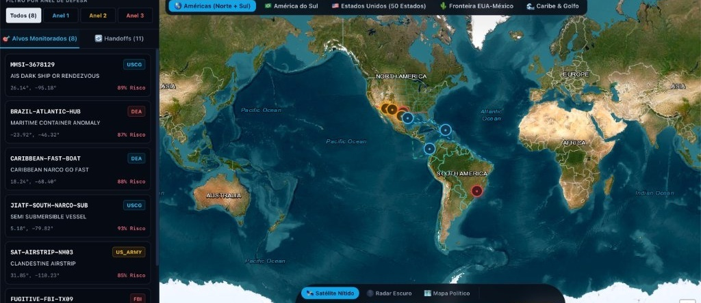
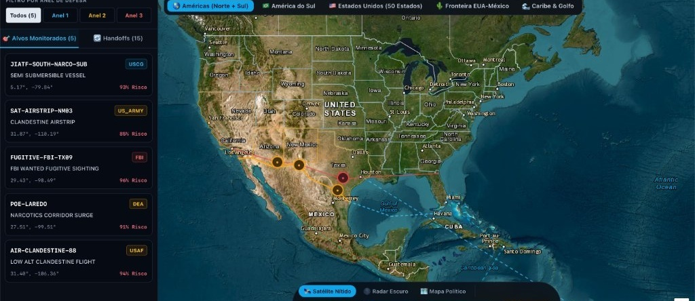
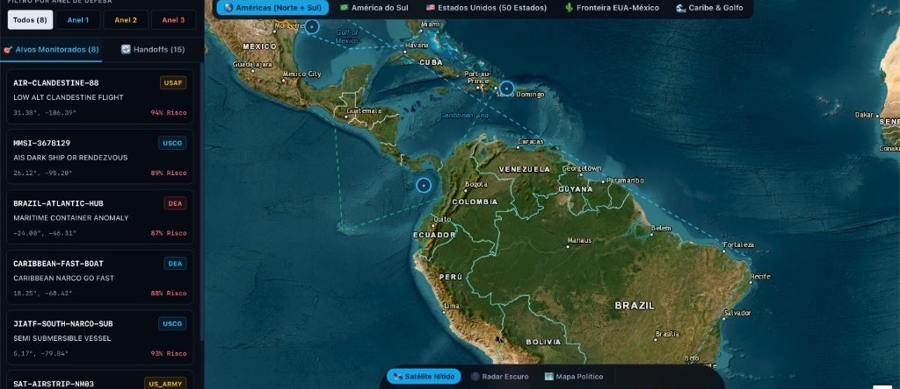
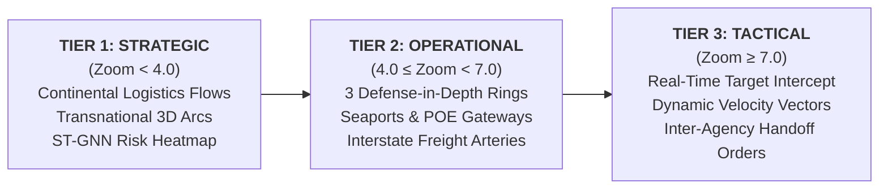

# PROJECT FRONTIER (FRONTIER-OS)
### Pan-American Homeland Defense & Transnational C4ISR System of Systems (SoS)

[](https://www.python.org/downloads/)
[](https://pytorch.org/)
[](https://h3geo.org/)
[](https://keda.sh/)
[](https://colab.research.google.com/github/maykonlincolnusa/FRONTIER-OS-Frontier-Operating-System-/blob/main/notebooks/colab/00_FRONTIER_C4ISR_Master_Colab_Training_Suite.ipynb)
[](https://postgis.net/)
[](https://redpanda.com/)
[](https://qdrant.tech/)
[](https://nextjs.org/)
[]()
[](LICENSE)

---

## 1. Executive Summary

**Project Frontier (FRONTIER-OS)** is an enterprise-grade **C4ISR** (*Command, Control, Communications, Computers, Intelligence, Surveillance, and Reconnaissance*) platform engineered for United States territorial integrity, transnational threat interdiction, and joint hemispheric enforcement.

The system federates real-time intelligence across **7 Pan-American Theaters of Operations** (USA, Brazil, Colombia, Mexico, Panama, Chile, and Argentina) to disrupt multimodal logistics networks operated by transnational syndicates:
* **Transnational Syndicates Monitored:** Primeiro Comando da Capital (`PCC`), Comando Vermelho (`CV`), Sinaloa Cartel (`SINALOA_CARTEL`), Cartel Jalisco Nueva Generación (`CJNG`), Clan del Golfo (`CLAN_DEL_GOLFO`), and Tren de Aragua (`TREN_DE_ARAGUA`).
* **Multimodal Conveyance:** Maritime Containers, Semi-Submersibles (LPVs), Riverine Barges (Hidrovía Paraná-Paraguay / Solimões), Clandestine Aircraft, Highway Freight (Kenworth tractor-trailers), and Panama Canal Transit.
* **Participating Agencies:**
  * **United States:** US Coast Guard (`USCG`), US Navy (`US_NAVY`), US Air Force (`USAF`), US Army (`US_ARMY`), Customs and Border Protection (`CBP`), Drug Enforcement Administration (`DEA`), Federal Bureau of Investigation (`FBI`), and US Department of Transportation (`USDOT`).
  * **Pan-American Partners:** Polícia Federal (`PF_BR`), Polícia Rodoviária Federal (`PRF_BR`), ANTAQ (`ANTAQ_BR`), Marinha do Brasil (`MARINHA_BR`), Força Aérea Brasileira (`FAB_BR`), Armada de Colombia (`ARMADA_CO`), Autoridad del Canal de Panamá (`ACP_PA`), Directemar Chile (`DIRECTEMAR_CL`), Prefectura Naval Argentina (`PREFECTURA_AR`), and `INTERPOL`.

---

## 2. Tactical Command & Control (C2) Visualizer

The tactical operations interface provides real-time situational awareness across the Western Hemisphere with high-definition satellite imagery, vector perimeter overlays, and low-latency WebSocket telemetry.

### Hemispheric Operational Theater (North & South America)
Pan-American surveillance linking South American cultivation and transshipment zones directly to US defense rings.


### Continental United States (50 States & 3 Defense Rings)
Full continental coverage displaying all 50 US states (US Census Bureau TIGER/Line), 200 NM EEZ, 100-mile statutory border zone, and interstate corridors (I-10, I-35, I-95).


### Transnational Supply Corridors (South America to US Entry Points)
Tracking Pacific semi-submersible routes, Caribbean maritime corridors, clandestine airstrips, and Atlantic container routes.


---

## 3. Advanced Tactical Command UX: 3-Level Semantic Zoom

To eliminate visual clutter while maintaining full tactical fidelity, the C2 interface implements a **3-Level Semantic Zoom** architecture:



1. **Tier 1: Strategic Level (`zoom < 4.0` - Continental Scale):**
   * Eliminates cluttered individual pins.
   * Renders glowing **Transnational Logistics Arcs** showing bulk criminal conveyance (Santos ➔ Panama ➔ Houston; Tumaco ➔ Manzanillo ➔ San Diego; Solimões ➔ Caribbean).
   * Displays **ST-GNN Risk Heatmap** circles at major transshipment bottlenecks.
2. **Tier 2: Operational Level (`4.0 <= zoom < 7.0` - National / Ring Scale):**
   * Renders the **3 Defense-in-Depth Rings** (`RING_1_MARITIME`, `RING_2_FEDERAL`, `RING_3_INTERSTATE`).
   * Displays critical strategic hubs: Port of Santos, Panama Canal, Manzanillo, Laredo POE, and domestic highway spines (I-10, I-35, BR-163, BR-277).
3. **Tier 3: Tactical Level (`zoom >= 7.0` - Interception Scale):**
   * Displays individual monitored targets with military ping animations.
   * Calculates and renders **Dynamic Velocity Vectors** (projected heading arrows scaled by speed in knots).
   * Enables one-click **"Authorize Inter-Agency Handoff"** action directly on the target dossier.

---

## 4. Uber H3 Spatial Sharding & Extreme System Elasticity

To scale the System of Systems across 7 countries and millions of events without PostGIS bottlenecks:

### 4.1. Uber H3 Spatial Pre-Filtering (`shared/geo/h3_index.py`)
* Computes discrete hexagonal spatial cells at **Resolutions 4, 6, and 8** in memory.
* Evaluates boundary candidates in **$O(1)$** time before triggering heavy PostGIS `ST_Contains` spatial queries.
* Indexes critical Pan-American maritime chokepoints (Panama Canal, Straits of Florida, Mona Passage, Yucatán Channel).

### 4.2. Backpressure, Circuit Breaker & Adaptive Dynamic Batching (`shared/concurrency/mp_engine.py`)
* `InferenceProcessPool` continuously monitors active queue depth.
* Activates backpressure safeguards when queue depth exceeds threshold, adaptively shrinking batch sizes to flush queues and maintain sub-second response times.

### 4.3. KEDA Event-Driven Kubernetes Autoscaling (`infra/keda/kafka-scaledobject.yaml`)
* Deploys `ScaledObject` resources targeting all 5 subsystem deployments.
* Automatically scales pod replicas from **1 to 10** based on real-time **Consumer Lag** across Redpanda topics (`raw.*`, `alerts.*`, and `events.jurisdiction.handoff`).

---

## 5. Microservices Mesh Architecture (Ports 8000–8006)

| Port | Service Identifier | Microservice Name | Primary Agencies | Deep Learning Model / Engine |
| :---: | :--- | :--- | :--- | :--- |
| **`:8000`** | `00-c2-gateway` | **C2 API Gateway & WebSocket Mesh** | JTF C4ISR | Cross-Ring Fusion Engine, Pan-American APIs & Advisory Locks |
| **`:8001`** | `01-maritime-coastline` | **Maritime & Blue Border Shield** | USCG, US Navy | `maritime_lstm.onnx` (`TrajectoryAnomalyLSTM`) + H3 Sharding |
| **`:8002`** | `02-airspace-shield` | **Airspace & Radar Shield** | USAF, CBP AMO, FAA | `airspace_ae.onnx` (`FlightStateAutoencoder`) |
| **`:8003`** | `03-narcotics-intel` | **Narcotics ST-GNN Intelligence** | DEA, CBP, HIDTA | `narcotics_stgnn.onnx` (`SpatioTemporalGNN`) + Latam OSINT |
| **`:8004`** | `04-criminal-interstate` | **Interstate Biometrics & ALPR** | FBI, DEA, State Police | `ArcFace-512` + `YOLOv8-ALPR` (Qdrant Vector DB) |
| **`:8005`** | `05-geospatial-recon` | **Orbital & Drone Recon** | US Army, NGA, CBP | `frontier_sat_yolov8.onnx` (Sentinel-2 / xView) |
| **`:8006`** | `06-c2-copilot` | **Multi-Agent Tactical Copilot** | Joint Command Staff | Multi-Agent RAG + Text-to-PostGIS + GraphRAG |

---

## 6. Google Colab GPU Training Suite (`notebooks/colab/`)

The repository includes 5 production-ready Jupyter notebooks pre-configured for **Google Colab** with NVIDIA GPUs (T4, L4, A100), PyTorch Mixed Precision (`torch.amp`), and automated dynamic-axes ONNX exports:

| Notebook | Focus & Mission Area | Output Weights | Open in Colab |
| :--- | :--- | :--- | :---: |
| **`00_FRONTIER_C4ISR_Master_Colab_Training_Suite.ipynb`** | End-to-end training of all 4 Deep Learning models using official US Government datasets. | `frontier_c4isr_onnx_weights.zip` | [](https://colab.research.google.com/github/maykonlincolnusa/FRONTIER-OS-Frontier-Operating-System-/blob/main/notebooks/colab/00_FRONTIER_C4ISR_Master_Colab_Training_Suite.ipynb) |
| **`01_Maritime_AIS_LSTM_Colab_GPU.ipynb`** | Sequential Autoencoder trained on MarineCadastre AIS time series for dark ship detection. | `maritime_lstm.onnx` | [](https://colab.research.google.com/github/maykonlincolnusa/FRONTIER-OS-Frontier-Operating-System-/blob/main/notebooks/colab/01_Maritime_AIS_LSTM_Colab_GPU.ipynb) |
| **`02_Airspace_ADSB_Autoencoder_Colab_GPU.ipynb`** | State-vector autoencoder trained on OpenSky Network ADS-B data for low-altitude flight detection. | `airspace_ae.onnx` | [](https://colab.research.google.com/github/maykonlincolnusa/FRONTIER-OS-Frontier-Operating-System-/blob/main/notebooks/colab/02_Airspace_ADSB_Autoencoder_Colab_GPU.ipynb) |
| **`03_Narcotics_STGNN_Corridors_Colab_GPU.ipynb`** | Graph Convolution + Temporal Attention trained on CBP POE seizures and HIDTA corridors. | `narcotics_stgnn.onnx` | [](https://colab.research.google.com/github/maykonlincolnusa/FRONTIER-OS-Frontier-Operating-System-/blob/main/notebooks/colab/03_Narcotics_STGNN_Corridors_Colab_GPU.ipynb) |
| **`04_Satellite_YOLOv8_xView_Recon_Colab_GPU.ipynb`** | Aerial/satellite patch detector for desert airstrips, convoys, and go-fast vessels. | `frontier_sat_yolov8.onnx` | [](https://colab.research.google.com/github/maykonlincolnusa/FRONTIER-OS-Frontier-Operating-System-/blob/main/notebooks/colab/04_Satellite_YOLOv8_xView_Recon_Colab_GPU.ipynb) |

---

## 7. Quickstart Guide

### Step 1: Start Infrastructure Containers
```bash
docker compose up -d
```

### Step 2: Launch the 7 Microservices Mesh
```bash
uv run python scripts/start_microservices_mesh.py
```

### Step 3: Run Pan-American Transnational Simulation
Simulate a multi-act cargo journey from Brazil / Colombia through Panama and Mexico into US Ring 3:
```bash
uv run python scripts/simulate_panamerican_corridor.py
```

### Step 4: Launch the Tactical Command Center Dashboard
```bash
npm run dev --prefix dashboard-c2
```
Open **`http://localhost:3000`** in your browser.

---

## 8. Verification & Automated Tests

Execute the full automated test suite covering concurrency controls, locks, ONNX inference, H3 spatial sharding, Pan-American schemas, and KEDA autoscaling manifests:
```bash
uv run pytest -q --tb=short
```
```text
...............................                                          [100%]
31 passed in 3.65s
```
