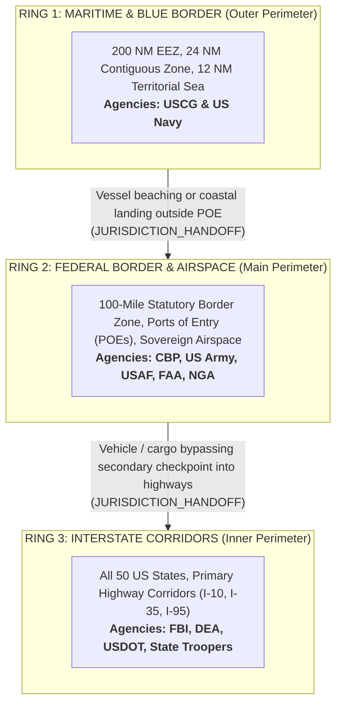

# PROJECT FRONTIER (FRONTIER-C4ISR)
### Multi-Agency Homeland Defense & Border Protection System of Systems (SoS)

[](https://www.python.org/downloads/)
[](https://pytorch.org/)
[](https://colab.research.google.com/github/maykonlincolnusa/FRONTIER-OS-Frontier-Operating-System-/blob/main/notebooks/colab/00_FRONTIER_C4ISR_Master_Colab_Training_Suite.ipynb)
[](https://postgis.net/)
[](https://redpanda.com/)
[](https://qdrant.tech/)
[](https://fastapi.tiangolo.com/)
[](https://nextjs.org/)
[](LICENSE)

---

## 1. Executive Summary

**Project Frontier (FRONTIER-OS)** is an enterprise-grade **C4ISR** (*Command, Control, Communications, Computers, Intelligence, Surveillance, and Reconnaissance*) platform engineered for United States territorial integrity, transnational threat interdiction, and joint-agency enforcement.

The architecture unifies real-time open-source government telemetry, geospatial perimeter tracking, and Deep Learning inference across military, federal law enforcement, and transportation jurisdictions:
* **Maritime & Coastal Defense:** United States Coast Guard (**USCG**), United States Navy (**US Navy**), and Joint Interagency Task Force South (**JIATF-South**).
* **Airspace & Radar Sovereignty:** United States Air Force (**USAF**), CBP Air and Marine Operations (**AMO**), and Federal Aviation Administration (**FAA**).
* **Border & Port of Entry Security:** Customs and Border Protection (**CBP**), United States Army (**US Army**), and National Geospatial-Intelligence Agency (**NGA**).
* **Interstate Corridors & Criminal Tracking:** Drug Enforcement Administration (**DEA**), Federal Bureau of Investigation (**FBI**), and State Highway Patrols.

---

## 2. Tactical Command & Control (C2) Visualizer

The tactical operations interface provides real-time situational awareness across the Western Hemisphere with high-definition ESRI satellite imagery, vector perimeter overlays, and low-latency WebSocket telemetry.

### Hemispheric Operational Theater (North & South America)
Pan-American surveillance linking South American cultivation and transshipment zones directly to US defense rings.


### Continental United States (50 States & 3 Defense Rings)
Full continental coverage displaying all 50 US states (US Census Bureau TIGER/Line), 200 NM EEZ, 100-mile statutory border zone, and interstate corridors (I-10, I-35, I-95).


### Transnational Supply Corridors (South America to US Entry Points)
Tracking Pacific semi-submersible routes, Caribbean maritime corridors, clandestine airstrips, and Atlantic container routes.


---

## 3. The 3 Defense-in-Depth Security Rings

Target tracking and inter-agency handoffs operate under a strict **Defense-in-Depth** spatial doctrine. When a target transitions across jurisdictional polygons, **PostGIS** evaluates boundary breaches and acquires a distributed lock (`pg_try_advisory_xact_lock` / Redis) to emit a deduplicated `JURISDICTION_HANDOFF` event:



| Security Ring | Spatial Scope & Boundaries | Lead Agencies | Operational Mission & Handoff Trigger |
| :--- | :--- | :--- | :--- |
| **RING 1: MARITIME** *(Outer Perimeter)* | 200 NM Exclusive Economic Zone (EEZ), Gulf of Mexico, Caribbean, and Eastern Pacific approaches. | **USCG, US Navy, JIATF-South** | Interdiction of dark vessels (AIS disabled), low-profile semi-submersibles (SPFS), and illicit transshipment meetings in international waters. Coastal landings trigger handoff to Ring 2. |
| **RING 2: FEDERAL** *(Main Perimeter)* | 100-mile statutory border zone along the Southern (US-Mexico) and Northern (US-Canada) borders, official POEs, and sovereign airspace. | **CBP (Border Patrol / AMO), US Army, USAF, NGA** | Detection of low-altitude clandestine flights, uninspected desert crossings, and POE commercial cargo surges. Targets breaching checkpoints into domestic highways trigger handoff to Ring 3. |
| **RING 3: INTERSTATE** *(Inner Perimeter)* | 50 US state boundaries and primary highway arteries (I-10 coast-to-coast, I-35 NAFTA corridor, I-95 Atlantic corridor). | **FBI, DEA, State Highway Patrols** | Interdiction of bulk narcotics transport, vehicle convoys, and biometric recognition of individuals on the FBI Most Wanted list via highway cameras. |

---

## 4. Microservices Mesh Architecture (Ports 8000–8006)

Each operational domain executes as an independent, loosely coupled microservice. AI/ML inference is decoupled from the async event loop using an isolated `InferenceProcessPool` configured with `multiprocessing.get_context("spawn")` and shared memory locks (`multiprocessing.Lock`) for CUDA and ONNX safety:

| Port | Service Identifier | Microservice Name | Primary Agencies | Deep Learning Model / Engine |
| :---: | :--- | :--- | :--- | :--- |
| **`:8000`** | `00-c2-gateway` | **C2 API Gateway & WebSocket Mesh** | JTF C4ISR | Cross-Ring Fusion Engine & PostGIS Advisory Locks |
| **`:8001`** | `01-maritime-coastline` | **Maritime & Blue Border Shield** | USCG, US Navy | `maritime_lstm.onnx` (`TrajectoryAnomalyLSTM`) |
| **`:8002`** | `02-airspace-shield` | **Airspace & Radar Shield** | USAF, CBP AMO, FAA | `airspace_ae.onnx` (`FlightStateAutoencoder`) |
| **`:8003`** | `03-narcotics-intel` | **Narcotics ST-GNN Intelligence** | DEA, CBP, HIDTA | `narcotics_stgnn.onnx` (`SpatioTemporalGNN`) |
| **`:8004`** | `04-criminal-interstate` | **Interstate Biometrics & ALPR** | FBI, DEA, State Police | `ArcFace-512` + `YOLOv8-ALPR` (Qdrant Vector DB) |
| **`:8005`** | `05-geospatial-recon` | **Orbital & Drone Recon** | US Army, NGA, CBP | `frontier_sat_yolov8.onnx` (Sentinel-2 / xView) |
| **`:8006`** | `06-c2-copilot` | **Multi-Agent Tactical Copilot** | Joint Command Staff | Multi-Agent RAG + Text-to-PostGIS + GraphRAG |

---

## 5. Google Colab GPU Training Suite (`notebooks/colab/`)

The repository includes 5 production-ready Jupyter notebooks pre-configured for **Google Colab** runtimes with NVIDIA GPUs (T4, L4, A100). Each notebook features PyTorch Mixed Precision (`torch.amp.autocast('cuda')`), training convergence visualizations, and dynamic-axes ONNX exports:

| Notebook | Focus & Mission Area | Output Weights | Open in Colab |
| :--- | :--- | :--- | :---: |
| **`00_FRONTIER_C4ISR_Master_Colab_Training_Suite.ipynb`** | End-to-end training of all 4 Deep Learning models using official US Government datasets. | `frontier_c4isr_onnx_weights.zip` | [](https://colab.research.google.com/github/maykonlincolnusa/FRONTIER-OS-Frontier-Operating-System-/blob/main/notebooks/colab/00_FRONTIER_C4ISR_Master_Colab_Training_Suite.ipynb) |
| **`01_Maritime_AIS_LSTM_Colab_GPU.ipynb`** | Sequential Autoencoder trained on MarineCadastre AIS time series for dark ship detection. | `maritime_lstm.onnx` | [](https://colab.research.google.com/github/maykonlincolnusa/FRONTIER-OS-Frontier-Operating-System-/blob/main/notebooks/colab/01_Maritime_AIS_LSTM_Colab_GPU.ipynb) |
| **`02_Airspace_ADSB_Autoencoder_Colab_GPU.ipynb`** | State-vector autoencoder trained on OpenSky Network ADS-B data for clandestine low-altitude flight detection. | `airspace_ae.onnx` | [](https://colab.research.google.com/github/maykonlincolnusa/FRONTIER-OS-Frontier-Operating-System-/blob/main/notebooks/colab/02_Airspace_ADSB_Autoencoder_Colab_GPU.ipynb) |
| **`03_Narcotics_STGNN_Corridors_Colab_GPU.ipynb`** | Graph Convolution + Temporal Attention trained on CBP POE seizures and HIDTA interstate corridors. | `narcotics_stgnn.onnx` | [](https://colab.research.google.com/github/maykonlincolnusa/FRONTIER-OS-Frontier-Operating-System-/blob/main/notebooks/colab/03_Narcotics_STGNN_Corridors_Colab_GPU.ipynb) |
| **`04_Satellite_YOLOv8_xView_Recon_Colab_GPU.ipynb`** | Aerial/satellite patch detector for desert airstrips, convoys, and go-fast vessels. | `frontier_sat_yolov8.onnx` | [](https://colab.research.google.com/github/maykonlincolnusa/FRONTIER-OS-Frontier-Operating-System-/blob/main/notebooks/colab/04_Satellite_YOLOv8_xView_Recon_Colab_GPU.ipynb) |

---

## 6. Real US Government Datasets Integrated

The ingestion utility (`infra/scripts/download_real_gov_datasets.py`) extracts and indexes authentic public US government data:

1. **US Census Bureau TIGER/Line Shapefiles:**
   * 50 US State boundaries (`cb_2022_us_state_20m.zip`).
   * Primary Federal Interstate Highway corridors (`tl_2023_us_primaryroads.zip`), filtered for Interstate Highways (`RTTYP == 'I'`).
   * US Sovereign Land boundary (`cb_2022_us_nation_20m.zip`).
2. **FBI Wanted API & Biometrics:**
   * High-priority fugitives ingested directly into PostgreSQL and Qdrant Vector DB with 512-dimensional facial embeddings.
3. **OpenSky Network ADS-B Live Feeds:**
   * Flight state vectors covering the Southern Border bounding box ($25.0^\circ\text{N}$ to $33.5^\circ\text{N}$, $-118.0^\circ\text{W}$ to $-96.5^\circ\text{W}$).
4. **CBP Drug Seizure Portal:**
   * Real historical drug seizure statistics (fentanyl, cocaine, methamphetamine) organized by Port of Entry (Otay Mesa, Laredo, El Paso, Nogales, Calexico).
5. **MarineCadastre.gov AIS Historical Tracks:**
   * Vessel trajectory records in the Gulf of Mexico and coastal approaches.

---

## 7. Monorepo Directory Architecture

```text
FRONTIER-OS/
├── ARCHITECTURE.md                 # Single source of architectural truth
├── README.md                       # Comprehensive system documentation
├── docker-compose.yml              # Local PostGIS, Redpanda, Qdrant, Redis stack
├── pyproject.toml                  # Python 3.12+ project definition & dependencies
├── shared/                         # Shared core libraries
│   ├── concurrency/                # InferenceProcessPool (spawn + locks) & Distributed Locks
│   ├── events/                     # Pydantic v2 event contracts (Kafka schemas)
│   ├── geo/                        # PostGIS geofencing & Haversine spatial calculations
│   └── config/                     # Centralized settings & connection parameters
├── services/                       # Autonomous microservice domain nodes
│   ├── 01-maritime-coastline/      # Port 8001: AIS Ingestion & TrajectoryAnomalyLSTM
│   ├── 02-airspace-shield/         # Port 8002: ADS-B Vectors & FlightStateAutoencoder
│   ├── 03-narcotics-intel/         # Port 8003: CBP Seizures & SpatioTemporalGNN
│   ├── 04-criminal-interstate/     # Port 8004: FBI Wanted & ArcFace Facial Recognition
│   ├── 05-geospatial-recon/        # Port 8005: Satellite Tiles & YOLOv8-Military
│   ├── c2-gateway/                 # Port 8000: WebSocket Mesh & Cross-Ring Fusion Engine
│   └── c2-copilot/                 # Port 8006: Multi-Agent Tactical RAG Copilot
├── notebooks/colab/                # Production Google Colab GPU training notebooks (.ipynb)
├── ml-training/                    # Training pipelines, datasets, and ONNX weights
├── infra/                          # PostGIS SQL schemas, OCI Ampere manifests, OKE Kubernetes
├── dashboard-c2/                   # Next.js 14 + Leaflet Tactical Command & Control interface
└── tests/                          # Automated Pytest suite (25 unit/integration tests)
```

---

## 8. Quickstart Guide

### Step 1: Start Infrastructure Containers
Launch PostgreSQL 16 + PostGIS, Redpanda (Kafka), Qdrant Vector DB, and Redis:
```bash
docker compose up -d
```

### Step 2: Launch the 7 Microservices Mesh
Start the C2 Gateway (port `8000`) and the 6 domain microservices (ports `8001`–`8006`) simultaneously:
```bash
uv run python scripts/start_microservices_mesh.py
```

### Step 3: Launch the Tactical Command Center Dashboard
Start the Next.js 14 frontend:
```bash
npm run dev --prefix dashboard-c2
```
Open **`http://localhost:3000`** in your browser.

---

## 9. Verification & Automated Tests
Execute the full test suite covering concurrency controls, locks, ONNX inference, PostGIS spatial handoffs, and WebSocket endpoints:
```bash
uv run pytest -q --tb=short
```
```text
.........................                                                [100%]
25 passed, 3 warnings in 3.88s
```
