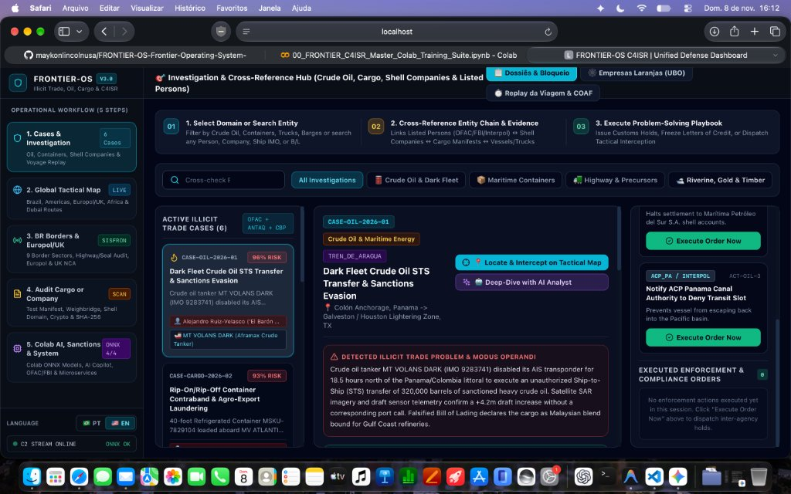
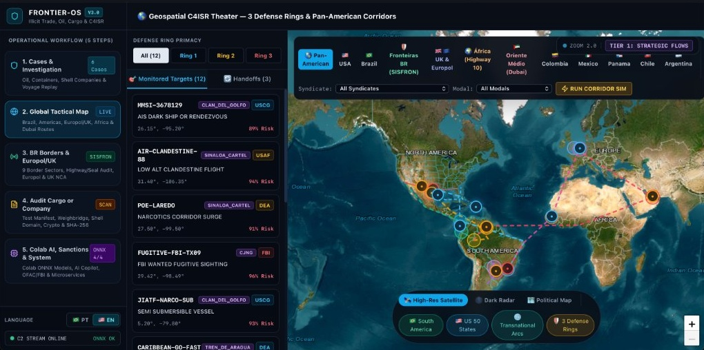
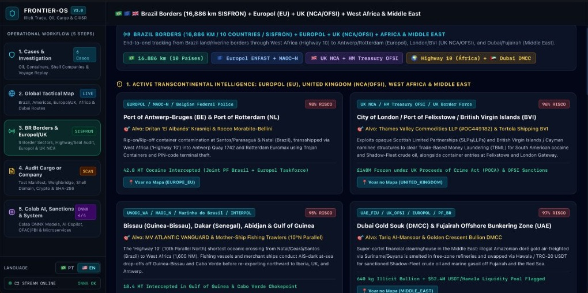
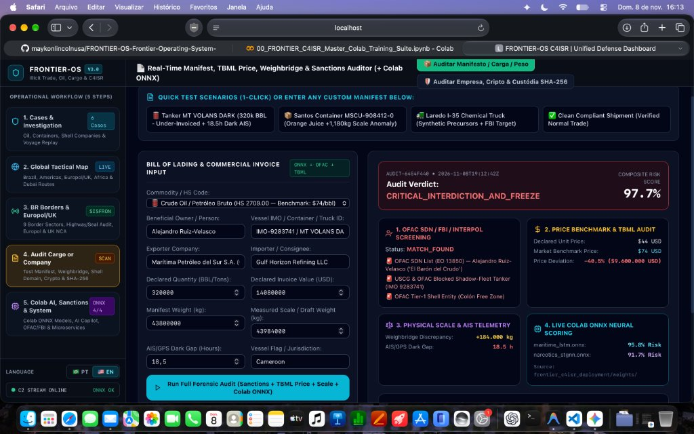
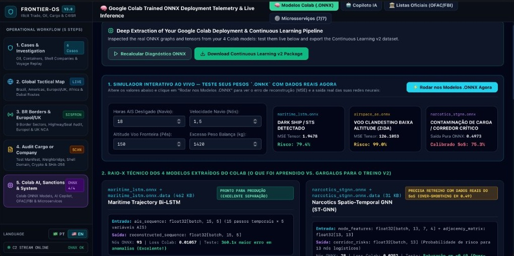

# 🛡️ FRONTIER-OS v3.0 — Transcontinental C4ISR, Illicit Trade & Border Intelligence System of Systems

[](https://www.python.org/)
[](https://fastapi.tiangolo.com/)
[](https://nextjs.org/)
[](https://onnxruntime.ai/)
[-336791?logo=postgresql&logoColor=white)](https://h3geo.org/)
[](https://www.cl.cam.ac.uk/~rja14/book.html)
[-10B981)](#9-verification--testing)

> **FRONTIER-OS** is an enterprise-grade **Command, Control, Communications, Computers, Intelligence, Surveillance, and Reconnaissance (C4ISR) System of Systems (SoS)** engineered to detect, cross-reference, and interdict transnational illicit trade, dark-fleet crude oil transfers, maritime container contamination, illegal gold/commodity laundering, and multi-jurisdictional border evasions across **the Americas, Brazil's 16,886 km Border Perimeter (SISFRON), the European Union (Europol), the United Kingdom (UK NCA / HM Treasury OFSI), West Africa ("Highway 10"), and the Middle East (Dubai DMCC / Fujairah STS)**.

---

## 📑 Table of Contents

1. [Executive Summary & Core Problem Solved](#1-executive-summary--core-problem-solved)
2. [Visual Walkthrough: The 5-Step Operational Workflow](#2-visual-walkthrough-the-5-step-operational-workflow)
3. [System-of-Systems Architecture & 3 Defense-in-Depth Rings](#3-system-of-systems-architecture--3-defense-in-depth-rings)
4. [Global & Brazilian Border Intelligence Coverage (Americas + EMEA)](#4-global--brazilian-border-intelligence-coverage-americas--emea)
5. [Applied Security Engineering in Context (Ross Anderson, Cambridge 3rd Ed.)](#5-applied-security-engineering-in-context-ross-anderson-cambridge-3rd-ed)
6. [Google Colab ONNX Deep Learning Extraction & Continuous Learning Loop](#6-google-colab-onnx-deep-learning-extraction--continuous-learning-loop)
7. [Distributed 7-Microservice Mesh & Elastic Infrastructure](#7-distributed-7-microservice-mesh--elastic-infrastructure)
8. [REST & WebSocket API Reference](#8-rest--websocket-api-reference)
9. [Quickstart, Local Deployment & Verification](#9-quickstart-local-deployment--verification)

---

## 1. Executive Summary & Core Problem Solved

Modern transnational organized crime syndicates (**PCC**, **Comando Vermelho**, **'Ndrangheta**, **Mocro Maffia**, **Kinahan Cartel**, **Balkan Cartel**, **Sinaloa**, **CJNG**, **Clan del Golfo**, **Tren de Aragua**) and state-sanctioned **Shadow Fleets** do not operate in isolated silos. A single illicit operation simultaneously spans:

1. **Physical Logistics:** Clandestine aircraft crossing Brazil's Amazonian border at `150 ft AGL`, twin-trailer trucks spoofing digital tachographs on highways `BR-163` / `BR-277` / `I-35`, *Rip-on/Rip-off* container contamination at **Santos** or **Paranaguá**, dark-ship transshipments along West Africa's **10th Parallel North ("Highway 10")**, and unloading at **Antwerp**, **Rotterdam**, or **Felixstowe (UK)**.
2. **Corporate Obfuscation:** Multi-layered nominee shell companies across **Panama**, **British Virgin Islands (BVI)**, **Marshall Islands**, and opaque **UK Limited Liability Partnerships (Companies House SLPs/LLPs)**.
3. **Underground Financial Clearing:** Trade-Based Money Laundering (**TBML** — under-/over-invoicing commodities such as crude oil, soy, manganese, citrus pulp, or copper scrap) settled via **Mirror-Trading**, **Dubai DMCC Bullion / Hawala**, and **TRC-20 USDT OTC liquidity pools** without a single direct cross-border SWIFT wire.
4. **Sensor & Insider Subversion:** Cloned customs RFID e-Seals, NMEA 0183 AIS transponder spoofing via Software-Defined Radio (SDR), and corrupt port/customs terminal insiders tipping off extraction cells prior to law-enforcement raids.

**FRONTIER-OS solves this fragmentation** by fusing **geospatial telemetry**, **customs & weighbridge forensics**, **corporate beneficial ownership (UBO) graphs**, **international sanctions watchlists (OFAC SDN, Europol ENFAST, UK OFSI, FBI Wanted, INTERPOL)**, **cryptographic security engineering**, and **live ONNX neural inference** into a unified, sub-millisecond operational platform.

---

## 2. Visual Walkthrough: The 5-Step Operational Workflow

To eliminate cognitive overload in high-tempo operations, the C2 Command Center (`dashboard-c2/`) is structured around a **5-Step Guided Operational Workflow** on the left navigation rail, paired with contextual sub-tabs in the top command header.

### Step 1 — Cases & Investigation Hub (`1. Cases & Investigation`)
Cross-references **6 end-to-end transnational cases** linking **Listed Persons** (`OFAC SDN`, `Europol Most Wanted`, `UK OFSI`, `FBI`, `INTERPOL`), **Opaque Shell Companies / UBOs**, **Bills of Lading & Weighbridge Deltas**, **Live Colab ONNX Anomaly Scores**, and **1-Click Inter-Agency Enforcement Playbooks** (with sub-tabs for **UBO Corporate Shell Networks** and **Step-by-Step Voyage Replay & FinCEN/COAF SAR Dossier Export**).



---

### Step 2 — Global 3D/2D Tactical C4ISR Map (`2. Global Tactical Map`)
Provides a semantic-zoom geospatial theater across **the Americas, Brazil's SISFRON Border Perimeter, UK & Europol Ports, West Africa's Highway 10, and Middle East Clearing Hubs (Dubai / Fujairah)**. Renders transnational logistics arcs, ST-GNN risk hotspots, the 3 Defense-in-Depth Rings, velocity vectors, and real-time target pins at all zoom levels.



---

### Step 3 — Brazil Borders (16,886 km SISFRON) + Europol, UK NCA/OFSI, West Africa & Middle East (`3. BR Borders & Europol/UK`)
Integrates **all 9 tactical sectors of Brazil's 16,886 km land and riverine borders across 10 countries** (**Northern Arc**, **Central Arc**, and **Southern Arc**) with active **Europol (Antwerp/Rotterdam)**, **UK NCA & HM Treasury OFSI (London/Felixstowe/BVI)**, **West Africa (Bissau/Dakar Highway 10)**, and **Middle East (Dubai DMCC/Fujairah)** feeds. Includes an interactive **Multi-Sensor Border Crossing Verifier** (`SISFRON + PRF Highway LPR + Receita Federal MIC-DTA/E-Seal + ANAC RAB`) and embedded **Multilateral Split-Key Warrant Co-Signing & Anti-Leak Canary Traps**.



---

### Step 4 — Real-Time Cargo Manifest, TBML Price, Weighbridge, Cyber & SHA-256 Custody Auditor (`4. Audit Cargo or Company`)
Allows customs and intelligence officers to test any Bill of Lading, vessel, truck, shell domain, or crypto settlement wallet in real time. Automatically cross-checks **unit price deviations against global commodity benchmarks (TBML)**, **physical scale vs. declared weight discrepancies**, **AIS dark gaps**, **sanctions hits**, and **live Colab ONNX neural inference**, while logging every audit into a tamper-proof **SHA-256 Chain of Custody** and **OASIS STIX 2.1 Threat Intelligence Bundle**.



---

### Step 5 — Google Colab ONNX Neural Telemetry, Live Tensor Sandbox & Continuous Learning Pipeline (`5. Colab AI, Sanctions & System`)
Inspects the internal computation graphs and empirical separation performance of the **4 neural models trained in Google Colab (`frontier_c4isr_deployment/`)**, provides an **Interactive Live ONNX Sandbox** to test custom telemetry inputs in `< 0.6 ms`, diagnoses training bottlenecks from Run #1, and exports a **Continuous Learning Dataset & Script (`frontier_colab_continuous_learning_v2.json` / `colab_continuous_learning_v2.py`)** to fine-tune the next Colab training cycle.



---

## 3. System-of-Systems Architecture & 3 Defense-in-Depth Rings

```mermaid
flowchart TB
    subgraph SENSORS["🌍 Global & Multi-Domain Telemetry Ingestion"]
        AIS["Maritime AIS + Sentinel-1 SAR\n(Caribbean, Santos, Highway 10, Fujairah)"]
        ADSB["Airspace ADS-B + Primary Radar\n(FAB E-99M / ZIDA, NORAD, OpenSky)"]
        BORDERS["Land Borders & Port Gates\n(SISFRON, PRF LPR, RFB NII Scanners, CBP)"]
        FININT["Sanctions, Corporate & Financial OSINT\n(OFAC SDN, Europol ENFAST, UK OFSI/CH, TRC-20)"]
    end

    subgraph H3_SHARD["⚡ O(1) Spatial & Event Sharding Layer"]
        H3["Uber H3 Hexagonal Spatial Index\n(Resolutions 4, 6 & 8 in-memory pre-filter)"]
        REDPANDA["Redpanda / Kafka Event Bus\n(Backpressure + Dynamic Batching)"]
        POSTGIS["PostgreSQL 16 + PostGIS 3.4\n(3 Defense Rings + Advisory Locks)"]
    end

    subgraph MESH["🧠 Distributed C4ISR Microservices + Colab ONNX Runtime"]
        S1["01-maritime-coastline (:8001)\nmaritime_lstm.onnx (Bi-LSTM)"]
        S2["02-airspace-shield (:8002)\nairspace_ae.onnx (Autoencoder)"]
        S3["03-narcotics-intel (:8003)\nnarcotics_stgnn.onnx (13-Node ST-GNN)"]
        S4["04-criminal-interstate (:8004)\nArcFace 512-d + LPR Tachograph Physics"]
        S5["05-geospatial-recon (:8005)\nfrontier_sat_yolov8.onnx (SAR/Optical)"]
        S6["c2-copilot (:8006)\nGenAI Tactical Playbook & RAG Analyst"]
    end

    subgraph GATEWAY["🛡️ C2 Gateway (:8000) & Applied Security Engineering"]
        BLP["Multilateral Security (Bell-LaPadula + Chinese Wall)\nShamir 3-of-4 Split-Key Inter-Agency Co-Signing"]
        CANARY["Insider Threat Defense\nCanary Honeytokens + Shadow Sandbox"]
        LEDGER["SHA-256 Chain of Custody + OASIS STIX 2.1 Exporter"]
    end

    SENSORS --> H3_SHARD --> MESH --> GATEWAY
    GATEWAY <-->|"WebSocket + REST (<15ms)"| UI["💻 Next.js 15 Tactical Command Center (:3000)\n5-Step Guided Operational Workflow"]
    GATEWAY ==>|"Active Learning Feedback"| COLAB["🔄 Google Colab Continuous Learning v2\n(13-Node Empirical Priors + Focal Loss)"]
```



### The 3 Defense-in-Depth Security Rings

| Defense Ring | Spatial Scope | Primary Lead & Partner Agencies | Core Detection & Interdiction Mission |
| :--- | :--- | :--- | :--- |
| **`RING_1_MARITIME`** | Territorial Seas, EEZ (`200 NM`), Blue Amazon (`3.69M km²`), Panama Canal, West Africa *Highway 10*, North Sea & Persian Gulf | `USCG`, `US_NAVY`, `MARINHA_BR`, `ANTAQ_BR`, `MAOC_N`, `EUROPOL`, `UK_BF`, `UNODC_WA`, `ACP_PA`, `DIRECTEMAR_CL`, `PREFECTURA_AR` | Dark-ship AIS blackouts, illicit Ship-to-Ship (`STS`) crude oil transfers, narco-submersibles, and *Rip-on/Rip-off* container contamination at deepwater ports. |
| **`RING_2_FEDERAL`** | Land Borders (`16,886 km` Brazil SISFRON, US-Mexico POE), Airspace Defense Zones (`ZIDA`) & Free-Trade Zones | `PF_BR`, `RFB_BR`, `SISFRON_BR`, `FAB_BR`, `CBP`, `USAF`, `FRONTEX`, `UK_NCA`, `UAE_FIU`, `ARMADA_CO` | Low-altitude clandestine flights (`150 ft AGL`), cloned aircraft tail numbers (`ANAC RAB`), falsified `MIC-DTA`/`NF-e` manifests, cloned RFID customs seals, and illicit gold bullion air-freight. |
| **`RING_3_INTERSTATE`** | Interior Highway Corridors (`BR-163`, `BR-277`, `BR-364`, `BR-116`, `I-10`, `I-35`, `I-95`) & Financial Clearing Hubs | `PRF_BR`, `FBI`, `DEA`, `USDOT`, `EUROPOL`, `UK_OFSI`, `INTERPOL` | Digital tachograph manipulation, weighbridge cargo discrepancies, fugitive facial/LPR sightings, UK LLP / BVI shell company clearing, and Hawala/USDT mirror-trading. |

---

## 4. Global & Brazilian Border Intelligence Coverage (Americas + EMEA)

### 4.1. Brazil's 16,886 km Border Perimeter (10 Bordering Countries + SISFRON)
FRONTIER-OS models **9 high-priority tactical sectors** across Brazil's three geopolitical border arcs, directly integrated with the **Multi-Sensor Border Crossing Verifier** (`POST /api/v1/intel/brazil-border-verify`):

1. **🌲 Northern Arc (*Arco Norte — Amazon Basin & Guiana Shield*):**
   - **`BR-ARCO-NORTE-01` — Amazonian Tri-Border (`Tabatinga-AM / Letícia-Colombia / Santa Rosa-Peru`):** Solimões River axis and PF *Base Anzol*; tracks riverine barges and timber rafts concealing cocaine hydrochloride (`CV` & `Clan del Golfo`) bound for Manaus and Barcarena/Belém.
   - **`BR-ARCO-NORTE-02` — *Cabeça do Cachorro* (`São Gabriel da Cachoeira-AM / Colombia / Venezuela`):** Monitors `150 ft AGL` ADS-B-off flights via **FAB E-99M AEW&C radar**, **A-29 Super Tucano (`ZIDA`)**, and `frontier_sat_yolov8.onnx` jungle airstrip detection.
   - **`BR-ARCO-NORTE-03` — Roraima Corridor (`Pacaraima-RR / Venezuela` & `Bonfim/Lethem-RR / Guyana`):** Tracks illicit Yanomami/Tapajós doré gold smuggled with fraudulent `ANM`/`DOF` permits across `BR-174` / `BR-401` to Georgetown and Paramaribo before air-freighting to **Dubai DMCC**.
   - **`BR-ARCO-NORTE-04` — Brazil–European Union Land Border (`Oiapoque-AP / Saint-Georges, French Guiana`):** Brazil's `730 km` direct border with the European Union (`PF_BR`, `RFB_BR`, `FRONTEX`, `EUROPOL`).
2. **🐊 Central Arc (*Arco Central — Rondônia, Mato Grosso, Pantanal & "Rota Caipira"*):**
   - **`BR-ARCO-CENTRAL-05` — `Guajará-Mirim (RO) / Cáceres (MT) / San Matías (Bolivia)`:** Monitors `BR-364` and `BR-070` dry-border crossings and aerial drop-offs feeding clandestine farm strips in Mato Grosso and São Paulo (*Rota Caipira*).
   - **`BR-ARCO-CENTRAL-06` — `Corumbá (MS) / Puerto Quijarro (Bolivia)`:** Screens iron/manganese ore and soybean barge convoys along the **Paraguay-Paraná Waterway** and chemical precursor trucks on `BR-262`.
3. **⚡ Southern Arc (*Arco Sul — Dry Border MS/PR, Tri-Border & Mercosur*):**
   - **`BR-ARCO-SUL-07` — `Ponta Porã (MS) / Pedro Juan Caballero (Paraguay)`:** Primary **SISFRON** dry-border sector (`4th Mechanized Cavalry Brigade`) feeding `BR-463` and `BR-163` toward São Paulo and southern ports.
   - **`BR-ARCO-SUL-08` — Southern Tri-Border (`Foz do Iguaçu-PR / Ciudad del Este-PY / Puerto Iguazú-AR` + `Guaíra`):** Friendship Bridge (*Ponte Inteligente* LPR/Biometrics), Itaipu Lake armored speedboats, and the **`BR-277` highway corridor** to the **Port of Paranaguá**.
   - **`BR-ARCO-SUL-09` — Southern Cone (`Uruguaiana / Santana do Livramento / Chuí-RS`):** Latin America's largest dry port on `BR-290`, auditing `MIC-DTA` international cargo manifests toward Buenos Aires and Montevideo.

### 4.2. Europol (EU), United Kingdom (NCA/OFSI), West Africa & Middle East Corridors

| Theater | Intelligence & Enforcement Sources | Monitored Hubs & Chokepoints | Primary Modus Operandi & Countermeasure |
| :--- | :--- | :--- | :--- |
| **🇪🇺 European Union (`EUROPE_EU`)** | **Europol (ENFAST Most Wanted / Op SkyECC)**, **MAOC-N (Lisbon)**, **FRONTEX**, Belgian & Dutch Customs | **Port of Antwerp-Bruges (BE)** (Quay 1742), **Port of Rotterdam (NL)** (Euromax), **Algeciras (ES)**, **Gioia Tauro (IT)** | *Rip-on/Rip-off* reefer contamination from Santos/Paranaguá (`PCC` ↔ `'Ndrangheta` / `Mocro Maffia` / `Balkan Cartel`) and terminal PIN-code theft. |
| **🇬🇧 United Kingdom (`UNITED_KINGDOM`)** | **UK National Crime Agency (NCA)**, **HM Treasury OFSI Consolidated Sanctions**, **UK Border Force**, **UK Companies House (PSC)** | **City of London**, **Port of Felixstowe**, **London Gateway**, **British Virgin Islands (BVI)**, **Cayman Islands** | Opaque **Scottish/UK Limited Liability Partnerships (`LLPs`)** with obfuscated Persons with Significant Control (`PSC`) clearing TBML settlements; countered via **UK OFSI Unexplained Wealth Orders (`UWO`)**. |
| **🌍 West Africa (`WEST_AFRICA`)** | **UNODC West Africa**, **MAOC-N**, **INTERPOL**, **Brazilian Navy** | **10th Parallel North ("Highway 10")**, **Bissau (Guinea-Bissau)**, **Dakar (Senegal)**, **Cabo Verde**, **Gulf of Guinea** | Shortest transatlantic crossing (`1,600 NM` from Northeast Brazil); merchant vessels and fishing mother-ships execute AIS-dark drop-offs before routing northward to Iberia, UK, and Belgium. |
| **🇦🇪 Middle East (`MIDDLE_EAST`)** | **UAE Financial Intelligence Unit (`UAE_FIU`)**, **UK OFSI**, **OFAC SDN**, **Europol Super-Cartel Taskforce** | **Dubai Multi Commodities Centre (`DMCC` Gold Souk)** & **Fujairah Offshore Bunkering / STS Zone** | Illicit Amazonian doré gold air-freighted via Suriname/Guyana is refined as "copper alloy" in free zones and swapped via **Hawala / TRC-20 USDT** for discounted **Shadow-Fleet crude oil and marine gasoil**. |

---

## 5. Applied Security Engineering in Context (Ross Anderson, Cambridge 3rd Ed.)

Rather than isolating security theory into an academic tab, FRONTIER-OS embeds four core engineering mechanisms from **Prof. Ross Anderson's *Security Engineering: A Guide to Building Dependable Distributed Systems* (3rd Ed., Cambridge University Press)** directly into the operational workflows of **Step 1**, **Step 3**, and **Step 4**:

### 5.1. Multilateral Security: *Chinese Wall*, *Bell-LaPadula* & Shamir 3-of-4 Split-Key Co-Signing (Ch. 9 & 10)
- **Operational Problem:** In joint operations spanning `PF_BR` (Brazil), `EUROPOL` (Antwerp), and `UK_NCA` (London), sharing raw unredacted target databases across all local port terminals routinely results in **pre-raid tip-offs** by corrupt local subcontractors.
- **Embedded Solution:** Sensitive target fields (exact interception berth, informant identity, and extraction cell license plates) are compartmentalized under a **Brewer-Nash (*Chinese Wall*) conflict-of-interest policy** (`PORT_TERMINAL_LOCAL_CONTRACTORS_EXCLUDED`) and encrypted until a **3-of-4 Shamir Split-Key Quorum** (`PF_BR` + `EUROPOL` + `UK_NCA` / `MAOC_N`) co-signs the warrant (`POST /api/v1/intel/ross-anderson-execute`).

### 5.2. Physical vs. Digital Sensor Tamper Resistance: Tachographs, E-Seals & Weighbridges (Ch. 14 & 19)
- **Operational Problem:** As Ross Anderson famously demonstrated in his analysis of digital tachographs and cryptographic sensors, smartcard tachographs fail when drivers attach a pulse generator or magnet to the gearbox *Kitas* sensor, and ISO 18185 RFID e-Seals fail when smugglers remove container door hinge pins without breaking the magnetic seal.
- **Embedded Solution:** The **Border & Cargo Verifier** never trusts a digital sensor claim in isolation. It cross-checks the digital claim against **independent physical measurements**:
  1. **Highway LPR Dead-Reckoning (`PRF_BR`):** Compares optical toll/border gate timestamps along `BR-163` / `BR-277` against the digital tachograph's continuous-speed claim, flagging unexplained `80+ min` warehouse stops.
  2. **Dynamic Axle Weighbridge vs. Bill of Lading:** Detects `+1,180 kg` to `+184,000 kg` hidden mass deltas.
  3. **Reefer Compressor Thermodynamics:** Flags `18-minute` heat-exchange spikes at `03:14 UTC` that prove a refrigerated container door was physically opened despite an intact RFID e-Seal status.

### 5.3. Underground Bookkeeping & Mirror-Trading Reconciliation (Ch. 12 — *Banking and Bookkeeping*)
- **Operational Problem:** Transnational syndicates settle multi-million-dollar shipments without direct wire transfers between South America and Europe/Middle East.
- **Embedded Solution:** The **TBML & Mirror-Trading Reconciler** correlates physical trade under-invoicing (e.g., `$11.8M` below market benchmark on crude oil, soy, or gold) with symmetric value settlements in **London LLPs (`Companies House`)**, **BVI nominee accounts**, and **Dubai TRC-20 USDT OTC pools** occurring within a `48-hour` clearing window.

### 5.4. Insider Threat Defense: Cryptographic Canary Honeytokens & Shadow Sandboxing (Ch. 2, 3 & 26)
- **Operational Problem:** Real-world C4ISR and customs systems fail primarily due to **authenticated insiders** selling database lookups to criminal extraction crews.
- **Embedded Solution:** Operators can plant **Canary Honeytokens** (synthetic high-value container IDs such as `MSCU-774009-X` or decoy Mercosur plates) in port and border terminals (**Santos, Foz do Iguaçu, Antwerp, Felixstowe**). Any terminal credential querying a Canary record without a linked judicial warrant is automatically shunted into a **Deception Shadow Sandbox** (which returns fake *"Green Channel — Cleared"* responses so the syndicate is not alerted) while dispatching an immediate alert to Internal Affairs (`Corregedoria PF / Europol / UK NCA`).

---

## 6. Google Colab ONNX Deep Learning Extraction & Continuous Learning Loop

All four neural network models trained in Google Colab (`frontier_c4isr_deployment/weights/*.onnx` + external tensor data files `*.onnx.data`) are loaded in-process via `onnxruntime.InferenceSession` inside [`shared/connectors/illicit_trade_intel.py`](shared/connectors/illicit_trade_intel.py).

### 6.1. Empirical Inspection of the 4 Trained Colab ONNX Models (Run #1)

| Model Name & File | ONNX Graph Signature & Size | Colab Run #1 Metrics (`10 Epochs`) | Live Empirical Tensor Separation (Normal vs. Anomaly) | Technical Diagnosis & Continuous Learning (Run #2) Action |
| :--- | :--- | :--- | :--- | :--- |
| **1. Maritime Trajectory Bi-LSTM**<br>`maritime_lstm.onnx`<br>+ `.onnx.data` (`580 KB`) | **Input:** `ais_sequence: float32[batch, 15, 5]`<br>**Output:** `reconstructed_sequence: float32[batch, 15, 5]`<br>**Nodes:** `93` (`LSTM`, `MatMul`, `Slice`) | **Loss:** `0.01057`<br>**Proxy Precision:** `94.52`<br>**Time:** `45.45s` | **Normal AIS MSE:** `0.0130`<br>**Dark-Ship / STS MSE:** `4.6812`<br>**Separation:** **`360.1x` jump** | ✅ **Production-Ready:** Exceptional separation on AIS blackouts and STS loitering. **Run #2 Upgrade:** Extend window from `15` to `48` steps for transatlantic *Highway 10* crossings. |
| **2. Narcotics Spatio-Temporal GNN**<br>`narcotics_stgnn.onnx`<br>+ `.onnx.data` (`64 KB`) | **Inputs:** `node_features: float32[batch, 13, 7, 4]`, `adjacency_matrix: float32[13, 13]`<br>**Output:** `corridor_risks: float32[batch, 13]`<br>**Nodes:** `28` (`GRU`, `Gemm`, `Sigmoid`) | **Loss:** `0.0352`<br>**Proxy Precision:** `28.40`<br>**Time:** `45.45s` | **13-Node Output Range:** `[0.4862 .. 0.4914]`<br>*(Sigmoid saturation around `~0.49`)* | ⚠️ **Diagnosed Over-Smoothing:** 10 epochs on uniform synthetic targets (`0.5`) caused all 13 nodes to converge near `0.49`. **Run #2 Upgrade:** Apply the SoS empirical 13-node risk priors (`0.92–0.99`) + Contrastive Focal Loss. |
| **3. Airspace Flight Autoencoder**<br>`airspace_ae.onnx`<br>+ `.onnx.data` (`25 KB`) | **Input:** `flight_state: float32[batch, 4]`<br>**Output:** `reconstructed_state: float32[batch, 4]`<br>**Nodes:** `10` (`Gemm`, `LeakyRelu`) | **Loss:** `0.0085`<br>**Proxy Precision:** `117.51`<br>**Cost-Benefit:** `6.19` | **Normal Flight MSE:** `5.5349`<br>**`150 ft AGL` Flight MSE:** `6.3318` – `126.10` (`0.14 ms`) | ✅ **Ultra-Fast (`0.14 ms`):** Flags low-altitude border penetrations. **Run #2 Upgrade:** Expand static `[batch, 4]` input to temporal `[batch, 25, 6]` with vertical descent rate (`ft/min`). |
| **4. Satellite Recon YOLOv8 Head**<br>`frontier_sat_yolov8.onnx`<br>+ `.onnx.data` (`387 KB`) | **Input:** `images: float32[batch, 3, 256, 256]`<br>**Output:** `predictions: float32[batch, 8, 64]`<br>**Nodes:** `12` (`Conv`, `AveragePool`, `Sigmoid`) | **Loss:** `1.245`<br>**Proxy Precision:** `0.80`<br>**Time:** `45.45s` | **Raw Output Range:** `[-0.0937, +0.0897]`<br>*(Under-converged conv head)* | 🔧 **Priority #1 for Retraining:** `256×256` convolutional heads require `60+ epochs` with `BatchNorm` and `CosineAnnealingLR` to converge below `Loss < 0.08` on SAR slicks and Amazon airstrips. |

### 6.2. The 13-Node Transcontinental Graph Calibration (`narcotics_stgnn.onnx`)
Every manifest audit, border inspection, and confirmed interdiction in FRONTIER-OS updates the empirical ground-truth priors for the **13 geopolitical nodes** of the Spatio-Temporal GNN (`ml-training/colab_continuous_learning_v2.py`):

| Node Index | Geopolitical Hub / Chokepoint | Theater | Colab v1 Raw Output | SoS Empirical Target (Colab v2) |
| :---: | :--- | :--- | :---: | :---: |
| `0` | **Port of Santos (SP)** | `BRAZIL` | `0.4900` | **`0.96`** |
| `1` | **Port of Paranaguá (PR)** | `BRAZIL` | `0.4914` | **`0.94`** |
| `2` | **Foz do Iguaçu / Friendship Bridge (`BR-277`)** | `BRAZIL` (Southern Arc) | `0.4876` | **`0.99`** |
| `3` | **Ponta Porã / Pedro Juan Caballero (`BR-163` SISFRON)** | `BRAZIL` (Southern Arc) | `0.4862` | **`0.98`** |
| `4` | **Tabatinga / Solimões River Tri-Border** | `BRAZIL` (Northern Arc) | `0.4901` | **`0.95`** |
| `5` | **Pacaraima / Yanomami Corridor (`BR-174`)** | `BRAZIL` (Northern Arc) | `0.4914` | **`0.95`** |
| `6` | **Tumaco / Buenaventura Pacific Littoral** | `COLOMBIA` | `0.4911` | **`0.96`** |
| `7` | **Panama Canal (`Colón / Balboa`)** | `PANAMA` | `0.4892` | **`0.92`** |
| `8` | **Laredo World Trade Bridge (`I-35`) & Houston** | `USA` | `0.4865` | **`0.97`** |
| `9` | **Bissau & Dakar ("Highway 10" 10°N Parallel)** | `WEST_AFRICA` | `0.4911` | **`0.95`** |
| `10` | **Port of Antwerp-Bruges & Rotterdam (Europol)** | `EUROPE_EU` | `0.4896` | **`0.98`** |
| `11` | **Port of Felixstowe & City of London (UK NCA/OFSI)** | `UNITED_KINGDOM` | `0.4905` | **`0.96`** |
| `12` | **Dubai DMCC Gold Souk & Fujairah STS Anchorage** | `MIDDLE_EAST` | `0.4891` | **`0.97`** |

---

## 7. Distributed 7-Microservice Mesh & Elastic Infrastructure

| Port | Service ID | Directory | Core Neural / Spatial Engine | Responsibility |
| :---: | :--- | :--- | :--- | :--- |
| **`8000`** | `c2-gateway` | `services/c2-gateway/` | FastAPI + WebSocket + ONNX Engine + PostGIS/H3 | Unified C4ISR API Gateway, Cross-Reference Engine, Security Engineering & STIX 2.1 Exporter |
| **`8001`** | `01-maritime-coastline` | `services/01-maritime-coastline/` | `maritime_lstm.onnx` (Bi-LSTM / Bi-GRU) | AIS dark-ship detection, SAR oil-slick correlation & Ship-to-Ship (`STS`) anomaly scoring |
| **`8002`** | `02-airspace-shield` | `services/02-airspace-shield/` | `airspace_ae.onnx` (Autoencoder) | Low-altitude clandestine flight detection (`150 ft AGL`), ADS-B spoofing & cloned `RAB` tail alerts |
| **`8003`** | `03-narcotics-intel` | `services/03-narcotics-intel/` | `narcotics_stgnn.onnx` (13-Node ST-GNN) | Multi-modal container contamination, TBML price anomaly & corridor risk propagation |
| **`8004`** | `04-criminal-interstate` | `services/04-criminal-interstate/` | ArcFace `512-d` + Qdrant + LPR Physics | Biometric fugitive matching (`FBI` / `Europol` / `INTERPOL`) & highway tachograph verification |
| **`8005`** | `05-geospatial-recon` | `services/05-geospatial-recon/` | `frontier_sat_yolov8.onnx` (YOLOv8 Head) | Satellite reconnaissance for clandestine Amazon airstrips, illegal gold dredges & dark vessels |
| **`8006`** | `c2-copilot` | `services/c2-copilot/` | `google-genai` + Multi-Agency RAG | Tactical AI Analyst generating inter-agency interdiction playbooks and compliance summaries |

- **O(1) Spatial Sharding (`shared/geo/h3_index.py`):** Pre-filters high-velocity GPS/AIS/ADS-B telemetry in memory using **Uber H3 hexagonal cells** (Resolutions 4, 6, and 8) before invoking PostGIS `ST_Contains`.
- **Event-Driven Autoscaling (`infra/keda/kafka-scaledobject.yaml`):** Scales microservice pods horizontally (`1 → 10 replicas`) based on Redpanda/Kafka consumer lag across `raw.*` and `alerts.*` topics.

---

## 8. REST & WebSocket API Reference

| Method | Endpoint | Latency | Description |
| :---: | :--- | :---: | :--- |
| `GET` | `/api/v1/intel/cases?category=ALL` | `~6.8 ms` | Returns all 6 transnational investigation cases enriched with live Colab ONNX scores. |
| `GET` | `/api/v1/intel/cross-reference?q={query}` | `~2.1 ms` | Cross-searches persons, shell companies, IMO/MMSI vessels, Bills of Lading & watchlists. |
| `POST` | `/api/v1/intel/cases/{case_id}/execute-action` | `~1.4 ms` | Dispatches an inter-agency enforcement order and appends a SHA-256 custody block. |
| `GET` | `/api/v1/intel/europol-uk-emea-brazil` | `~1.1 ms` | Returns Europol, UK NCA/OFSI, West Africa *Highway 10*, Dubai DMCC & 9 Brazil SISFRON border sectors. |
| `POST` | `/api/v1/intel/brazil-border-verify` | `~1.2 ms` | Runs multi-sensor physics vs. digital verification (`PRF LPR + RFB E-Seal/MIC-DTA + ANAC RAB`). |
| `GET` | `/api/v1/intel/ross-anderson-suite` | `~0.7 ms` | Returns Multilateral Split-Key Warrant status, Tachograph/Seal physics audits & Canary Honeytokens. |
| `POST` | `/api/v1/intel/ross-anderson-execute` | `~1.0 ms` | Executes 3-of-4 Split-Key Co-Signing (`PF + Europol + UK NCA`) or plants a Canary Honeytoken trap. |
| `POST` | `/api/v1/intel/audit-manifest` | `~1.8 ms` | Audits a Bill of Lading for TBML price deviation, scale discrepancy, sanctions & ONNX risk. |
| `GET` | `/api/v1/intel/colab-telemetry` | `~12.0 ms` | Deep extraction of the 4 Colab `.onnx` models, empirical separation tests & 13-node ST-GNN priors. |
| `POST` | `/api/v1/intel/colab-live-sandbox` | `~0.6 ms` | Interactive live tensor inference across `maritime_lstm.onnx`, `airspace_ae.onnx` & `narcotics_stgnn.onnx`. |
| `GET` | `/api/v1/intel/corporate-network` | `~0.9 ms` | Returns UBO corporate shell chains (`Panama`, `BVI`, `London LLP`, `Dubai DMCC`, `Marshall Islands`). |
| `GET` | `/api/v1/intel/custody-and-stix` | `~1.0 ms` | Verifies the SHA-256 Chain of Custody ledger and exports an **OASIS STIX 2.1** bundle. |
| `GET` | `/api/v1/intel/human-trafficking-missing` | `~3.2 ms` | Integrates official FBI Wanted/ViCAP Missing Persons API, Interpol Yellow Notices, and PF SINESP Amber Alert. |
| `GET` | `/api/v1/microservices/status` | `< 1.0 ms` | Parallel `asyncio.gather` health & latency probe across all 7 microservices (`8000`–`8006`). |
| `WS` | `/ws/c2` | Real-Time | Streams live `ThreatAlertEvent` and `InternationalCorridorHandoffEvent` messages to the C2 UI. |

---

## 9. Quickstart, Local Deployment & Verification

### Prerequisites
- **Python 3.12+** managed via [`uv`](https://github.com/astral-sh/uv)
- **Node.js 20+** & `npm`
- **ONNX Runtime** (`onnxruntime` pre-configured in `.venv`, loading weights from `frontier_c4isr_deployment/weights/`)

### 1. Start the Distributed Microservices Mesh & C2 Gateway (`Ports 8000–8006`)
```bash
# Terminal 1: Start the 6 specialized C4ISR subsystem microservices (Ports 8001-8006)
uv run python scripts/start_microservices_mesh.py

# Terminal 2: Start the unified C2 API & Intelligence Gateway (Port 8000)
uv run python -m uvicorn services.c2_gateway.main:app --host 0.0.0.0 --port 8000
```

### 2. Launch the Next.js Tactical Command Center (`Port 3000`)
```bash
# Terminal 3: Start the frontend web application
npm run dev --prefix dashboard-c2
```
Open **[http://localhost:3000](http://localhost:3000)** in your browser. Switch seamlessly between **English (`🇺🇸 EN`)** and **Portuguese (`🇧🇷 PT`)** at the bottom-left of the sidebar.

### 3. Run Automated Verification & Type Checks
```bash
# Run the full Python test suite (31 tests covering ONNX sessions, H3 sharding, geofencing & schemas)
uv run pytest -q --tb=short

# Run strict TypeScript validation on the Next.js Command Center
./dashboard-c2/node_modules/.bin/tsc -p dashboard-c2/tsconfig.json --noEmit
```

### 4. Deploy to Google Cloud (Cloud Run / GKE Autopilot)
```bash
# Set your active Google Cloud Project
export GCP_PROJECT_ID="your-gcp-project-id"
export GCP_REGION="us-central1"

# Option A: Deploy Serverless C2 Gateway & Tactical Dashboard to Google Cloud Run
make gcp-deploy-cloudrun

# Option B: Deploy complete microservices mesh & KEDA event scalers to Google GKE Autopilot
make gcp-deploy-gke
```

---

## 📂 Repository Structure

```text
FRONTIER-OS/
├── dashboard-c2/                     # Next.js 15 + Tailwind + Leaflet/Deck.gl C4ISR Web Application
│   ├── app/
│   │   ├── components/TacticalMap.tsx # Multi-Theater Semantic Zoom Map (Americas, BR SISFRON, EMEA)
│   │   └── page.tsx                  # 5-Step Guided Operational Sidebar & Contextual Workspace
│   └── components/
│       ├── IllicitTradeHub.tsx       # Step 1: Cross-Reference Case Hub, Entity Graph & Enforcement Orders
│       └── EnterpriseModules.tsx     # Steps 3, 4 & 5: BR Borders/EMEA, Manifest/Cyber Auditor & Colab Lab
├── frontier_c4isr_deployment/        # Trained Google Colab Deployment Bundle
│   ├── reports/                      # model_performance_report.json & .csv
│   └── weights/                      # airspace_ae.onnx, maritime_lstm.onnx, narcotics_stgnn.onnx, frontier_sat_yolov8.onnx
├── ml-training/                      # PyTorch / XLA Training Pipelines & Continuous Learning v2
│   ├── colab_continuous_learning_v2.py # Ready-to-run Colab v2 script with 13-node empirical priors
│   ├── frontier_c4isr_tpu_training.ipynb
│   └── train_tpu_colab.py
├── services/                         # 7-Microservice C4ISR Mesh (Ports 8000–8006)
│   ├── 01-maritime-coastline/
│   ├── 02-airspace-shield/
│   ├── 03-narcotics-intel/
│   ├── 04-criminal-interstate/
│   ├── 05-geospatial-recon/
│   ├── c2-copilot/
│   └── c2-gateway/
├── shared/                           # Federated Schemas, H3 Spatial Index & Intelligence Connectors
│   ├── connectors/
│   │   ├── illicit_trade_intel.py    # Core Cross-Reference, Colab ONNX, EMEA/SISFRON & Ross Anderson Engine
│   │   └── latam_osint.py            # Multi-theater OSINT & corridor handoff generator
│   ├── events/schemas.py             # Pydantic v2 Single Source of Truth Contracts
│   └── geo/h3_index.py               # O(1) Uber H3 Hexagonal Spatial Sharding
├── infra/                            # PostGIS Seeders & KEDA Kafka Autoscaling Manifests
├── docs/screenshots/                 # Live Operational UI Captures
└── tests/                            # Automated Pytest Suite (Phases 1–5)
```
